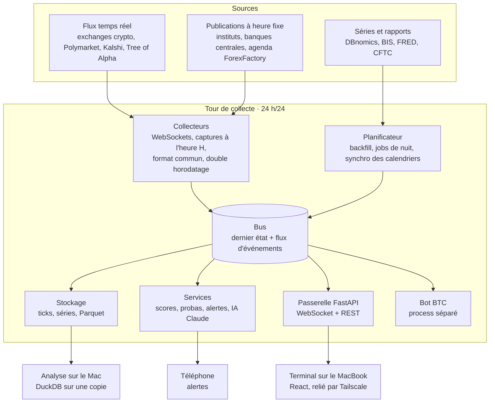

# Plan — Terminal de trading personnel

> **Export du document « Plan — Terminal de trading personnel »** (Claude Docs, 19/10/2026).
> Ce plan reste la référence fonctionnelle : modules, sources, formules, roadmap. Quatre points ont bougé depuis, et `CLAUDE.md` fait foi :
>
> 1. D'après `drexbot/docs/deploiement.md`, la tour collecte en **Python natif sur Windows, sans WSL**. Les mentions de WSL2 ci-dessous sont donc probablement caduques (à confirmer, voir `CLAUDE.md`).
> 2. Le bus Redis et le trio QuestDB / Postgres / Parquet sont **à reconfirmer en P0** (voir `CLAUDE.md`, « Décisions à confirmer »).
> 3. Le design system de référence est celui des maquettes (`design/`, `docs/design-system.md`), pas le tableau « Interface et design system » plus bas.
> 4. « Alfred » est le nom de l'assistant de Trade Sider. Chez nous, le module s'appelle **Assistant** (nom définitif à choisir). On ne reprend ni le nom, ni le logo, ni les textes de Trade Sider.

Oct 19, 2026 · @Clément

## Objectif et périmètre

On construit un terminal personnel qui reprend les modules de Trade Sider (macro, heatmap fondamentale, probabilités de taux, sentiment, actus avec assistant IA). On y ajoute ce que Trade Sider n'a pas : la microstructure BTC en temps réel et la capture des chiffres macro à la seconde de leur publication.

- **Marchés** : BTC en priorité (bot et trading manuel), les 8 devises majeures pour la lecture macro, les indices US et les ETF du PEA.
- **Usage** : strictement personnel, sans redistribution. C'est ce qui garde les données gratuites ou bon marché ; un passage en SaaS changerait les licences.
- **Machines** : la tour sous WSL2 collecte et calcule 24 h/24, le MacBook affiche et analyse.
- **Repris de Trade Sider** : la navigation par sections, la heatmap par devise, la fiche pays, les probabilités de taux avec Polymarket, la jauge de risque, l'assistant vocal.
- **Fait mieux** : des scores relatifs entre devises, la capture automatique des chiffres à la publication, la microstructure BTC, et une source plus une heure affichées sur chaque widget.

## Ce que montre Trade Sider

Trade Sider est un terminal orienté forex et macro : 23 pages en 6 sections, un assistant IA vocal (Alfred), quatre horloges (Tokyo, Londres, Paris, New York) et une esthétique noir et or. Les cinq pages capturées sont les modèles à reproduire.

| Page | Ce qu'on y voit | À reprendre | À corriger |
| --- | --- | --- | --- |
| News Feed | article traduit en français, file de titres, panneau Alfred pour interroger l'article | traduction + questions sur l'article | phrases collées sans espace (« intérieursC'est »), signe d'un assemblage automatique de titres |
| Macro (fiche pays) | inflation US sur 5 ans, réel contre prévision, historique « enregistré par l'app » | enregistrer soi-même chaque publication | — |
| Fundamental Heatmap | score par devise (AUD +64 … CAD −11), fiche BoJ, lecture IA, comparateur de paires, matrice taux / inflation / croissance / emploi / activité / sentiment | la matrice et le comparateur | 6 devises sur 8 « bullish » en même temps : en forex, un biais doit être relatif |
| Risk Sentiment | jauge 0–100 (30, risk-off), 7 composantes en percentile sur un an, S&P 500, VIX | la méthode en percentiles | clôtures quotidiennes de Yahoo Finance : lent et non officiel |
| Rates | trajectoire implicite des taux, probas de la prochaine réunion (85,2 % statu quo), même chose côté Polymarket (86,5 %), votes des comités | tout, y compris la comparaison des deux sources | — |

Pages du menu non capturées : Overview, Charts, Session Recap, Market Hours, Calendar, Bank Research, Squawk, Retail Sentiment, COT, Bank Positioning, Markets Watch, Seasonality, Technical Heatmap, Indicators, Liquidity, Track Record, Risk Calculator.

## Carte des modules

Le terminal compte 24 modules livrés en 8 phases (P0 à P7, détaillées dans la roadmap). On garde l'organisation du menu de Trade Sider, qui est claire, et on y ajoute la microstructure BTC et les alertes.

| Section | Module | Référence | Notre version | Phase |
| --- | --- | --- | --- | --- |
| Global | Barre de commande + espaces de travail | Bloomberg `<GO>`, Launchpad · TS Customize Workspace | commandes `BTC GP`, `USD ECO`, panneaux liés, mises en page sauvegardées | P0 |
| Global | Overview / Markets Watch | Bloomberg MON, WEI · TS | watchlist multi-actifs avec mini-graphiques | P0 |
| Global | Charts | Bloomberg GP, GIP · TS | sessions, plus hauts/bas veille et semaine, VWAP | P0 |
| Global | Market Hours | TS (barre du haut) | horloges TOK / LON / PAR / NY, sessions ouvertes, compte à rebours | P0 |
| Global | Session Recap | TS | résumé IA de chaque session Asie, Londres, New York | P6 |
| Global | Alfred (assistant) | TS | questions sur un article, un chiffre, un graphique ; puis la voix | P6 |
| News | Calendar | Bloomberg ECO · TS | capture à la seconde, surprise, historique enregistré | P1 |
| News | News Feed | Bloomberg TOP, N · TS | crypto + macro + banques centrales, traduit en français | P1 |
| News | Squawk | TS | lecture vocale des titres urgents | P1 |
| News | Alertes | Bloomberg ALRT | prix, chiffres, mots-clés, liquidations | P1 |
| News | Bank Research | TS | notes publiques des banques, résumées | P7 |
| Macro | Rates | Bloomberg WIRP · TS | probas Polymarket et Kalshi, puis calcul depuis les futures ; votes des comités | P2 |
| Macro | Macro (fiches pays) | TS | 8 économies, séries longues + publications enregistrées | P3 |
| Analyse | Fundamental Heatmap | TS | scores relatifs, comparateur de paires, lecture IA | P3 |
| Sentiment | Risk Sentiment | TS | jauge 0–100 en percentiles sur un an | P4 |
| Sentiment | COT | TS | rapport CFTC hebdo : devises, indices, BTC du CME | P4 |
| Sentiment | Retail Sentiment | TS | ratios long/short des exchanges crypto | P4 |
| Sentiment | Bank Positioning | TS | positions des banques sur les futures (CFTC, mensuel) | P4 |
| Analyse | Liquidity | TS | liquidité nette de la Fed (bilan − compte du Trésor − reverse repo) | P4 |
| Analyse | Microstructure BTC | — (façon Bookmap) | carnet agrégé, heatmap de profondeur, CVD, liquidations, funding, OI | P5 |
| Compte | Track Record | Bloomberg PORT · TS | journal, statistiques, positions OKX | P6 |
| Compte | Risk Calculator | TS | taille de position + règles de prop firm | P6 |
| Analyse | Seasonality, Technical Heatmap, Indicators | TS | rendements saisonniers, tendances par unité de temps | P7 |
| Analyse | Options BTC | Bloomberg OMON | Deribit : volatilité implicite, skew | P7 |

## Calendrier économique

Le calendrier croise le consensus de ForexFactory avec le chiffre officiel capté à la seconde. Chaque publication est ensuite enregistrée : c'est notre propre historique, comme le « real recorded history » de Trade Sider.

### Sources

| Besoin | Source | Remarque |
| --- | --- | --- |
| Agenda + consensus | flux JSON public de ForexFactory ([détail](https://apify.com/ichigowa/economic-calendar-pro)) | semaine en cours, suivante et précédente ; seulement la prévision et le chiffre précédent, jamais le réel |
| Chiffre réel | site ou API de l'institut à l'heure pile (BLS, BEA, Eurostat, INSEE, ONS, StatCan, ABS…) | pour CPI et NFP, tout le monde reçoit le chiffre en même temps depuis la fin des lock-ups presse en 2020 ([BLS](https://www.bls.gov/bls/discontinuing-department-of-labor-media-lockup-effective-june-3.pdf)) |
| Secours | titres du fil d'actus (« US CPI 3.7% vs 3.6% est. ») analysés automatiquement | couvre vite tous les pays, moins fiable |
| Historique long | DBnomics, FRED, OCDE | sert à remplir 10 ans d'historique au démarrage |
| Dates officielles | calendriers des instituts, synchronisés chaque jour | les dates bougent : en 2026, le rapport emploi de janvier est passé du 6 au 11 février ([BLS](https://www.bls.gov/bls/2025-lapse-revised-release-dates.htm)) |

### Capture à la publication

1. T − 10 min : connexion ouverte vers la source, parseur testé sur la publication précédente.
2. De T − 2 s à T + 60 s : interrogation serrée de la source, dans ses limites, et écoute du fil d'actus en parallèle.
3. Premier chiffre valide : enregistrement à la milliseconde, calcul de la surprise, alerte sonore, bandeau et squawk.
4. T + 30 min : enregistrement de la réaction de BTC, EUR/USD et du Nasdaq, pour mesurer l'impact de chaque type de surprise.

La surprise est normalisée par l'écart type des surprises passées du même indicateur (par exemple ses 24 dernières publications) :

```latex
z = \frac{\text{réel} - \text{consensus}}{\sigma(\text{surprises passées})}
```

On garde la première publication et ses révisions séparément. Les séries officielles écrasent la première version, alors que c'est elle, face au consensus, qui a fait bouger le marché.

### Interface

- Vue semaine filtrable par devise et importance, heures affichées à Paris, stockées en UTC.
- Compte à rebours sur le prochain événement important ; la ligne passe de « en attente » au chiffre réel, coloré selon la surprise.
- Fiche indicateur : barres réel contre consensus sur 5 ans et table des publications enregistrées.
- Alertes à T − 5 min, à la publication et au-delà d'un seuil de surprise réglable.

Les fuseaux sont le piège classique. La décision de la Fed du 28 octobre tombe à 14 h heure de New York ([Fed](https://www.federalreserve.gov/newsevents/2026-october.htm)), donc à 19 h à Paris : l'Europe passe à l'heure d'hiver le 25 octobre, les États-Unis le 1er novembre.

## Heatmap fondamentale

La heatmap note les 8 devises majeures sur 7 thèmes, puis classe leurs scores les uns contre les autres. En forex, une devise n'est haussière que face à une autre : un score relatif évite d'afficher six devises « bullish » en même temps.

### Indicateurs et sources

| Thème | Indicateur | Lecture | Historique | Dernier chiffre |
| --- | --- | --- | --- | --- |
| Taux | taux directeur, dernier mouvement, trajectoire attendue | hausse, maintien ou baisse, plus ce que le marché anticipe | BIS : plus de 40 banques centrales, données quotidiennes publiées vers le milieu de semaine ([BIS](https://www.bis.org/statistics/cbpol/cbpol_doc.pdf)) | communiqué de la banque centrale le jour même |
| Inflation | CPI global et sous-jacent sur 1 an | écart à la cible de chaque banque (2 % pour la plupart, 2–3 % pour la RBA, 0–2 % pour la BNS) | DBnomics, qui agrège OCDE, Eurostat et instituts nationaux et archive chaque révision ([DBnomics](https://docs.db.nomics.world/)) | calendrier enregistré |
| Croissance | PIB trimestriel | au-dessus ou au-dessous de sa moyenne sur 5 ans | DBnomics | calendrier enregistré |
| Emploi | taux de chômage | variation sur 3 mois, une hausse compte négativement | DBnomics | calendrier enregistré |
| Activité | PMI manufacturier et services | au-dessus ou au-dessous de 50, et tendance | l'historique complet est réservé aux abonnés de S&P Global : on le construit en enregistrant chaque publication | calendrier enregistré |
| Sentiment | confiance des consommateurs | variation | DBnomics | calendrier enregistré |
| Surprises | indice de surprise maison | moyenne pondérée des surprises z des 3 derniers mois | notre calendrier | — |

### Modèle de score

1. Pour chaque devise c et chaque thème k, on calcule un signal brut x (par exemple l'écart de l'inflation à la cible).
2. On le normalise parmi les 8 devises, pas dans l'absolu.
3. Le score est la somme pondérée des signaux normalisés, ramenée entre −100 et +100.
4. Le biais est relatif : les 3 meilleures devises sont haussières, les 3 dernières baissières, les 2 du milieu neutres.

```latex
z_{c,k} = \frac{x_{c,k} - \bar{x}_k}{\sigma_k} \qquad S_c = \sum_k w_k \, z_{c,k}
```

Le comparateur de paires affiche S\_A − S\_B, le gagnant de chaque thème et un verdict du type « les fondamentaux favorisent l'USD sur 6 thèmes sur 7 ». La lecture IA rédige 4 à 6 lignes à partir des seuls chiffres calculés, datées, chaque chiffre renvoyant à sa source.

### Interface

- Bandeau des 8 devises triées par score, avec barre et biais.
- Fiche devise : taux directeur, dernier mouvement, prochaine réunion avec compte à rebours, jauge inflation contre cible, historiques sur 5, 10 et 20 ans.
- Matrice devises × thèmes : état, chiffre et flèche dans chaque case, un clic ouvre la série et ses publications.
- Comparateur de paires et lecture IA dans la colonne de droite.

Avant d'en faire un signal, on teste si les variations de score anticipent les mouvements des devises à 1 et 3 mois. Tant que ce n'est pas démontré, la heatmap reste un outil de contexte. Pour BTC, c'est surtout la colonne USD qui compte.

## Probabilités de taux

Les probabilités viennent de trois sources de précision croissante : Polymarket et Kalshi (gratuits), l'API FedWatch (25 $/mois), puis notre propre calcul à partir des futures. Sur la capture, Trade Sider affiche sa propre estimation et celle de Polymarket côte à côte : 85,2 % et 86,5 % de statu quo.

### Sources

| Source | Couverture | Coût et accès | Limites |
| --- | --- | --- | --- |
| Polymarket (Data API v2) | Fed, et selon les réunions BCE, BoE, BoJ | gratuit, sans clé ([doc](https://docs.polymarket.com/api-reference/data-api/overview.md)) | historique fin limité (minute sur 7 jours, 5 min sur 60 jours, 30 min sur 90 jours, puis 3 h ou 12 h) ; marchés hors Fed peu liquides : 357 $ de volume sur 24 h pour la BCE de juin 2026 ([Polyguana](https://polyguana.com/market/1654347)) |
| Kalshi | Fed et indicateurs éco | données de marché publiques sans clé, WebSocket avec authentification ([doc](https://docs.kalshi.com/getting_started/quick_start_market_data)) | usage personnel uniquement |
| CME FedWatch API | Fed, dérivée des futures fed funds 30 jours, historique depuis 2015 | 25 $/mois en fin de journée ; flux intraday toutes les 60 s sur devis ([CME](https://www.cmegroup.com/market-data/market-data-api/fedwatch-api.html)) | pas d'intraday au palier de base |
| Calcul maison | Fed, puis BCE et BoE via les futures €STR et SONIA | prix des futures (Databento ou courtier) | demande un flux futures en temps réel |

### Calcul à partir des futures

Le prix P d'un future fed funds donne le taux moyen attendu sur le mois : 100 − P. Pour un mois de N jours avec une réunion le jour d, on en déduit le taux attendu après la réunion, puis la probabilité d'un mouvement de 25 points de base. On enchaîne ensuite réunion par réunion ; c'est la méthode de FedWatch, simplifiée.

```latex
r_{\text{après}} = \frac{N\,(100 - P) - d\,r_{\text{avant}}}{N - d} \qquad p_{25} = \frac{r_{\text{après}} - r_{\text{avant}}}{0{,}25}
```

### Interface

- Trajectoire implicite : taux attendu à chaque réunion, comparé au taux actuel.
- Prochaine réunion : barres −50, −25, statu quo, +25, +50 points de base, une couleur par source.
- Évolution des cotes : courbe dans le temps avec les publications du calendrier superposées, pour voir quel chiffre a déplacé les anticipations.
- Alerte quand deux sources divergent au-delà d'un seuil réglable.
- Comités et votes : décision, répartition des votes et dissidents, tirés des communiqués officiels. La Fed, la BoE et la BoJ publient leurs votes, la BCE non.

On enregistre nous-mêmes un instantané des probabilités chaque minute : l'historique fin reste disponible après l'expiration des fenêtres de Polymarket.

## Autres modules

Les autres modules réutilisent les mêmes briques : collecteurs, calendrier enregistré et service IA. Presque tout est faisable avec des sources gratuites.

| Module | Contenu | Sources | Point d'attention |
| --- | --- | --- | --- |
| News Feed + Alfred | titres dédoublonnés, classés par actif, pays et urgence ; traduction française ; questions sur l'article ouvert | Tree of Alpha : flux principal ouvert à tous, sources avancées et sans délai pour les abonnés ([doc](https://docs.treeofalpha.com/websockets)) ; RSS de la Fed, de la BCE et des fils de communiqués | traduire titre par titre, pour ne pas coller les phrases comme Trade Sider |
| Squawk et voix | lecture des titres urgents, puis Alfred vocal (mot d'activation, transcription, Claude, synthèse vocale) | synthèse vocale du navigateur au départ | la voix vient en dernier |
| Risk Sentiment | jauge 0–100 : moyenne des percentiles sur 252 séances de 7 composantes ; zones risk-off sous 40, risk-on au-dessus de 60 | FRED : VIX, S&P 500 avec 10 ans d'historique quotidien, écart de crédit high yield limité à 3 ans d'historique depuis avril 2026 ([FRED](https://fred.stlouisfed.org/graph/?g=1XVfO)) ; taux BCE pour AUD/JPY ; exchanges pour BTC | 3 ans suffisent pour un percentile sur 1 an |
| COT | positions nettes par catégorie et leur percentile sur 3 ans : devises, indices, BTC du CME | CFTC, publié chaque vendredi à 15 h 30 heure de New York pour les positions du mardi, avec une API ([CFTC](https://www.cftc.gov/MarketReports/CommitmentsofTraders/AbouttheCOTReports/index.htm)) | donnée déjà vieille de 3 jours à sa sortie |
| Bank Positioning | positions agrégées des banques sur les futures | rapport mensuel de la CFTC, premier vendredi du mois, données du premier mardi ([CFTC](https://cftc.gov/MarketReports/BankParticipationReports/index.htm)) | mensuel : contexte de fond uniquement |
| Retail Sentiment | ratios long/short des comptes et funding, mesure de l'encombrement | API publiques de Binance, OKX et Bybit | le forex attendra une source fiable |
| Liquidity | liquidité nette de la Fed (bilan − compte du Trésor − reverse repo) et profondeur du carnet BTC à ±1 % | FRED : WALCL, WTREGEN, RRPONTSYD ; exchanges | la liquidité nette est hebdomadaire |
| Microstructure BTC | carnet agrégé, heatmap de profondeur, CVD spot et perp, gros trades, liquidations, funding, OI, positions publiques des gros comptes Hyperliquid | WebSockets des exchanges | Binance ne pousse qu'une liquidation par symbole et par seconde ([doc](https://developers.binance.com/en/docs/products/derivatives-trading-usds-futures/websocket-market-streams/Liquidation-Order-Streams)) : agréger plusieurs plateformes |
| Market Hours + Session Recap | horloges TOK, LON, PAR, NY, sessions ouvertes ; résumé IA de chaque session | nos données + calendrier | tout en UTC côté serveur |
| Track Record + Risk Calculator | journal, statistiques, positions OKX ; taille de position selon le stop et les règles de prop firm | API OKX avec une clé en lecture seule, journal existant | jamais de clé de trading dans le terminal |
| Seasonality, Technical Heatmap | rendements moyens par mois, jour et heure ; tendance et RSI par actif et unité de temps | notre historique | calculs de nuit sur la tour |
| Options BTC | volatilité implicite, skew, DVOL | API publique de Deribit | en dernier |

## Sources de données consolidées

Le socle tient entièrement avec des sources gratuites. Seuls les futures en temps réel (199 $/mois) et les actions US en temps réel (99 $/mois) demandent un abonnement, et aucun n'est nécessaire avant la phase 7.

| Donnée | Source | Coût | Fréquence | Modules |
| --- | --- | --- | --- | --- |
| Crypto : trades, carnet, funding, OI, liquidations | WebSockets OKX, Binance, Bybit, Coinbase, Hyperliquid | gratuit | temps réel | Watch, Charts, Microstructure |
| Options BTC | API publique Deribit | gratuit | temps réel | Options |
| On-chain | mempool.space, API Hyperliquid | gratuit | temps réel | Microstructure, Alertes |
| Actus crypto et macro | Tree of Alpha ([doc](https://docs.treeofalpha.com/websockets)), RSS des banques centrales et des fils de communiqués | gratuit avec délai, abonnement sans délai | temps réel | News, Squawk |
| Agenda et consensus | flux JSON ForexFactory ([détail](https://apify.com/ichigowa/economic-calendar-pro)) | gratuit | toutes les heures | Calendar |
| Chiffres publiés | sites et API des instituts | gratuit | à la seconde | Calendar, Heatmap |
| Séries macro longues | DBnomics ([doc](https://docs.db.nomics.world/)), FRED, OCDE | gratuit | quotidienne | Macro, Heatmap, Liquidity |
| Taux directeurs | BIS ([doc](https://www.bis.org/statistics/cbpol/cbpol_doc.pdf)) + communiqués officiels | gratuit | hebdomadaire, jour J par communiqué | Rates, Heatmap |
| Probabilités de taux | Polymarket, Kalshi | gratuit | minute | Rates |
| FedWatch | API CME ([page](https://www.cmegroup.com/market-data/market-data-api/fedwatch-api.html)) | 25 $/mois | quotidienne | Rates |
| Futures CME et Eurex (fed funds, Nasdaq, S&P, BTC, €STR) | Databento Standard : temps réel, licences personnelles CME et Eurex incluses jusqu'à 2 appareils ([tarifs](https://databento.com/pricing), [licences](https://databento.com/docs/portal/live-data)) | 199 $/mois | temps réel | Rates (calcul maison), Watch |
| Futures SONIA (BoE) | Databento, ICE Europe Financials | 740 $ par site + 123 $ par terminal et par mois ([licences](https://databento.com/docs/portal/live-data)) | temps réel | trop cher : marchés de prédiction à la place |
| Actions et ETF US | Alpaca Basic : IEX, 30 symboles en WebSocket ; Algo Trader Plus : toutes les bourses US et options OPRA ([Alpaca](https://docs.alpaca.markets/us/docs/about-market-data-api)) | gratuit ou 99 $/mois | temps réel | Watch, Charts |
| VIX, S&P 500, crédit, bilan de la Fed | FRED ([notes](https://fred.stlouisfed.org/graph/?g=1XVfO)) | gratuit | quotidienne ou hebdomadaire | Risk Sentiment, Liquidity |
| COT et positions des banques | CFTC ([COT](https://www.cftc.gov/MarketReports/CommitmentsofTraders/AbouttheCOTReports/index.htm), [BPR](https://cftc.gov/MarketReports/BankParticipationReports/index.htm)) | gratuit | hebdomadaire, mensuelle | COT, Bank Positioning |
| Ratios long/short crypto | API Binance, OKX, Bybit | gratuit | intraday | Retail Sentiment |
| Fondamentaux d'ETF et d'actions | Alpha Vantage : 25 requêtes par jour en gratuit ([limites](https://www.macroption.com/alpha-vantage-api-limits/)) | gratuit ou 49,99 $/mois | quotidienne | PEA |
| Positions du PEA | saisie manuelle : XTB a coupé son API le 14 mars 2025 ([XTB](https://www.xtb.com/cy/help-center/our-platforms-2/do-you-offer-api-2)) | — | à chaque opération | Track Record |
| IA (traduction, lectures, récaps, Alfred) | API Claude | à l'usage | à la demande | News, Heatmap, Session Recap, Alfred |

Toutes ces licences sont valables pour un usage personnel. FRED l'indique noir sur blanc pour les données ICE : usage interne uniquement, aucune redistribution.

## Architecture technique et modèle de données

Tout tourne sur la tour : deux portes d'entrée (collecteurs et planificateur), un bus unique, puis quatre consommateurs qui lisent ce bus sans se gêner. Seul le terminal sort de la tour, par Tailscale.



Le bot BTC lit le même bus que le terminal mais tourne dans son propre process : un bug d'affichage ne peut pas le faire tomber.

### Choix techniques

- Collecteurs et services en Python (asyncio) : ccxt, client Databento et ODP d'OpenBB y sont natifs.
- Bus Redis Streams, qui garde aussi le dernier état de chaque instrument.
- QuestDB pour les ticks, un Postgres local sur la tour pour le reste (pas le Supabase partagé avec l'app Joyo), Parquet journalier pour l'archive copiée sur le Mac.
- Passerelle FastAPI : une seule connexion WebSocket multiplexée, un instantané à l'abonnement puis les seuls changements.
- Front React + Vite + TypeScript : dockview, Lightweight Charts, TanStack Table, cmdk ; messages décodés dans un Web Worker et écran rafraîchi 10 à 20 fois par seconde au plus.
- Horloge de WSL2 surveillée, puisque les mesures de latence en dépendent.

### Modèle de données

| Table | Contenu clé | Alimentée par | Lue par |
| --- | --- | --- | --- |
| `events` | source, symbole, type, contenu, heure de la source, heure de réception | collecteurs | Charts, Microstructure |
| `instruments` | symbole, plateforme, classe d'actif, fuseau | saisie + API | tous les modules |
| `series`, `observations` | identifiant, pays, unité, source ; période, valeur, millésime | planificateur | Macro, Heatmap, Liquidity |
| `releases` | indicateur, période, heure prévue (UTC), consensus, précédent, réel, révisé, heure de capture | calendrier | Calendar, Heatmap, indice de surprise |
| `meetings`, `decisions` | banque, date, décision, répartition des votes, dissidents | planificateur + communiqués | Rates |
| `probabilities` | réunion, issue, source, probabilité, horodatage | collecteurs | Rates |
| `scores` | devise, thème, signal, score, date | services | Heatmap |
| `news` | source, titre, texte, traduction, actifs, urgence, horodatages | collecteurs + IA | News Feed, Alfred |
| `alerts` | règle, état, dernier déclenchement | toi + services | Alertes |
| `journal` | date, actif, sens, taille, entrée, sortie, résultat, notes | OKX + saisie | Track Record |

## Interface et design system

On reprend la grammaire visuelle de Trade Sider (fond noir, accent or, micro-titres en capitales espacées) avec nos propres tokens, et on y ajoute la barre de commande façon Bloomberg. Les polices viennent du design system Prisme, déjà prêt.

- **Disposition** : barre latérale par sections (Global, News, Macro, Sentiment, Analyse, Compte, Perso), barre du haut (horloges, Alfred, alertes, latence des flux), zone centrale en panneaux, colonne droite contextuelle (Alfred ou détail).
- **Barre de commande** : Ctrl K ou « / », grammaire TICKER FONCTION. Exemples : `BTC GP` (graphique), `USD ECO` (calendrier), `FED WIRP` (probabilités), `JPY FA` (fiche devise), `BTC BOOK` (carnet).
- **Règle d'or** : chaque widget affiche sa source et l'heure de sa dernière mise à jour.
- **Lisibilité** : jamais la couleur seule, toujours une flèche ou un mot ; chiffres tabulaires alignés à droite ; flash de 300 ms sur un changement de prix.
- **Multi-écrans** : Tauri pour détacher un panneau dans sa propre fenêtre.

| Rôle | Valeur proposée | Usage |
| --- | --- | --- |
| Fond | #050505 | page |
| Surface | #101010, bordure #1F1F1F | cartes et panneaux |
| Accent | or #E8B931 | marque, élément sélectionné, onglet actif |
| Hausse | cyan #3FB6C6 | variations positives, biais haussier |
| Baisse | corail #E5625C | variations négatives, biais baissier |
| Texte | #EDEDED principal, #8C8C8C secondaire | tout le texte |
| Chiffres | JetBrains Mono, chiffres tabulaires | prix, tables, jauges |
| Titres | Space Grotesk | titres de pages et de fiches |
| Micro-titres | capitales, interlettrage 0,12 em, 11 px | en-têtes de cartes |

Composants à construire une fois et réutiliser partout : carte KPI, jauge, cellule de heatmap, barres de probabilité, table de publications, carte d'actu, panneau Alfred, sparkline, heatmap de profondeur.

## Roadmap

La roadmap compte 8 phases. Chacune se termine par une porte : un critère simple qui dit qu'elle est finie et qu'on peut passer à la suivante.

| Phase | Contenu | Porte de sortie |
| --- | --- | --- |
| P0 — Socle temps réel | collecteur OKX, bus, passerelle, barre de commande, watchlist, graphique, horloges | BTC en direct à l'écran, latence affichée |
| P1 — Calendrier et actus | agenda et capture des chiffres US, publications enregistrées, actus traduites, squawk, alertes | le CPI US capté et affiché en moins d'une seconde |
| P2 — Taux | page Taux : Polymarket et Kalshi, trajectoire, historique des cotes, votes des comités | probabilités de la prochaine réunion de la Fed mises à jour chaque minute |
| P3 — Macro et heatmap | fiches des 8 économies, backfill DBnomics et BIS, scores relatifs, comparateur, lecture IA | score testé sur l'historique avant de s'en servir |
| P4 — Sentiment et liquidité | jauge de risque, COT, positions des banques, ratios long/short, liquidité nette de la Fed | chaque widget affiche sa source et sa fraîcheur |
| P5 — Microstructure BTC | carnet agrégé, heatmap de profondeur, CVD, liquidations multi-plateformes, funding, OI | une séance entière suivie depuis le seul terminal |
| P6 — Assistant et compte | questions sur les articles, récap de session, voix, journal, positions OKX, calculateur prop firm | l'assistant ne cite que nos données, sources à l'appui |
| P7 — Extras | recherche bancaire, saisonnalité, heatmap technique, options Deribit, probas via les futures | seulement si un vrai besoin apparaît |

P0 et P1 forment déjà un terminal utilisable au quotidien. Les phases 2 à 4 reproduisent l'essentiel de Trade Sider, la 5 apporte ce qu'il n'a pas.

## Budget

Le terminal démarre à 0 $ par mois, hors API Claude et électricité de la tour. Le premier vrai coût, 199 $, n'arrive qu'avec les futures en temps réel, et il reste optionnel.

| Palier | Ce qu'il ajoute | Coût mensuel | Quand |
| --- | --- | --- | --- |
| 0 — gratuit | crypto, macro, calendrier, Polymarket, Kalshi, FRED, CFTC, BIS, DBnomics, Tree of Alpha avec délai, Alpaca IEX | 0 $ + API Claude à l'usage | P0 à P4 |
| 1 — FedWatch | probabilités officielles du CME en fin de journée | 25 $ | si l'on veut une référence en plus de Polymarket |
| 2 — futures | Databento Standard : fed funds, Nasdaq, S&P, BTC CME et €STR en temps réel, calcul maison des probabilités | 199 $ (rend le palier 1 inutile) | P7, en option |
| Option — actions US | Alpaca Algo Trader Plus : toutes les bourses US et options | 99 $ | seulement si tu trades des actions US |

Le coût de l'API Claude se mesure pendant la phase 1. On le contient en traduisant avec le plus petit modèle et en mettant en cache chaque traduction et chaque lecture.

## Risques et points de vigilance

Le plus grand risque n'est pas technique : c'est de vouloir 24 modules en même temps. Chaque phase doit être utile seule avant de passer à la suivante.

| Risque | Parade |
| --- | --- |
| Disperser le projet | une phase à la fois, chacune utilisable seule ; rien de la P7 avant que la P1 serve tous les jours |
| Licences et conditions d'utilisation | usage strictement personnel ; un passage en SaaS impose de tout renegocier |
| Sources qui changent ou se taisent | contrôle de fraîcheur par flux, badge « périmé » sur le widget, alerte si un flux se tait |
| Dates, fuseaux, révisions | calendrier synchronisé chaque jour, UTC partout, première publication et révisions stockées à part |
| IA qui invente | Alfred ne reçoit que nos données, cite chaque chiffre et ne fait aucun calcul lui-même |
| Faux signal | heatmap et jauge testées sur l'historique avant de servir à décider |
| Illusion de vitesse | le terminal aide à comprendre plus vite ; il ne battra pas les machines |
| Ligne rouge légale | jamais d'information non publique : règlement MAR pour les actions, MiCA pour la crypto |
| Sécurité | clés côté serveur uniquement, en lecture seule pour le terminal, accès par Tailscale |
| Tour unique, partagée avec le bot | services du terminal limités en mémoire et en CPU pour ne jamais gêner le bot, redémarrage automatique, sauvegarde quotidienne des Parquet |

## Prochaines étapes

Les actions ci-dessous couvrent la phase 0 et lancent la phase 1. La première dépend d'une réponse de ta part.

- [ ] Préciser en quoi est écrit le collecteur du bot et où il stocke ses données, pour décider si le terminal s'y branche.
- [ ] Créer le dépôt : `collectors/` en Python, `gateway/` en FastAPI, `web/` en React + Vite.
- [ ] P0 : collecteur OKX (trades et carnet BTC) vers Redis, puis WebSocket vers une watchlist et un graphique, latence affichée.
- [ ] P0 : barre du haut avec les horloges TOK, LON, PAR et NY calculées depuis l'UTC.
- [ ] P1 : importer le flux ForexFactory de la semaine et créer la table des publications enregistrées.
- [ ] P1 : capter le CPI US à la seconde sur le site du BLS et calculer la surprise.
- [ ] Défi optionnel : une page Rates minimale (Polymarket et Kalshi) prête pour la décision de la Fed du Oct 28, 2026.

## Sources

- [BLS — Discontinuing Department of Labor media lockup (2020)](https://www.bls.gov/bls/discontinuing-department-of-labor-media-lockup-effective-june-3.pdf)
- [BLS — Revised release dates following the 2025 and 2026 lapses](https://www.bls.gov/bls/2025-lapse-revised-release-dates.htm)
- [Federal Reserve — Calendar, October 2026](https://www.federalreserve.gov/newsevents/2026-october.htm)
- [Economic Calendar Pro — ForexFactory feed](https://apify.com/ichigowa/economic-calendar-pro)
- [BIS — Central bank policy rates, data documentation](https://www.bis.org/statistics/cbpol/cbpol_doc.pdf)
- [DBnomics — Documentation](https://docs.db.nomics.world/)
- [CME Group — FedWatch API](https://www.cmegroup.com/market-data/market-data-api/fedwatch-api.html)
- [Polymarket — Data API v2](https://docs.polymarket.com/api-reference/data-api/overview.md)
- [Kalshi — Quick Start: Market Data](https://docs.kalshi.com/getting_started/quick_start_market_data)
- [Polyguana — ECB June 2026 market](https://polyguana.com/market/1654347)
- [Tree of Alpha — Websockets](https://docs.treeofalpha.com/websockets)
- [FRED — ICE BofA and S&P 500 series notes](https://fred.stlouisfed.org/graph/?g=1XVfO)
- [CFTC — About the COT Reports](https://www.cftc.gov/MarketReports/CommitmentsofTraders/AbouttheCOTReports/index.htm)
- [CFTC — Bank Participation Reports](https://cftc.gov/MarketReports/BankParticipationReports/index.htm)
- [Binance — Liquidation Order Streams](https://developers.binance.com/en/docs/products/derivatives-trading-usds-futures/websocket-market-streams/Liquidation-Order-Streams)
- [Databento — Pricing](https://databento.com/pricing)
- [Databento — Plans and live data](https://databento.com/docs/portal/live-data)
- [Alpaca — About Market Data API](https://docs.alpaca.markets/us/docs/about-market-data-api)
- [Macroption — Alpha Vantage API request limits](https://www.macroption.com/alpha-vantage-api-limits/)
- [XTB — Do you offer API?](https://www.xtb.com/cy/help-center/our-platforms-2/do-you-offer-api-2)
